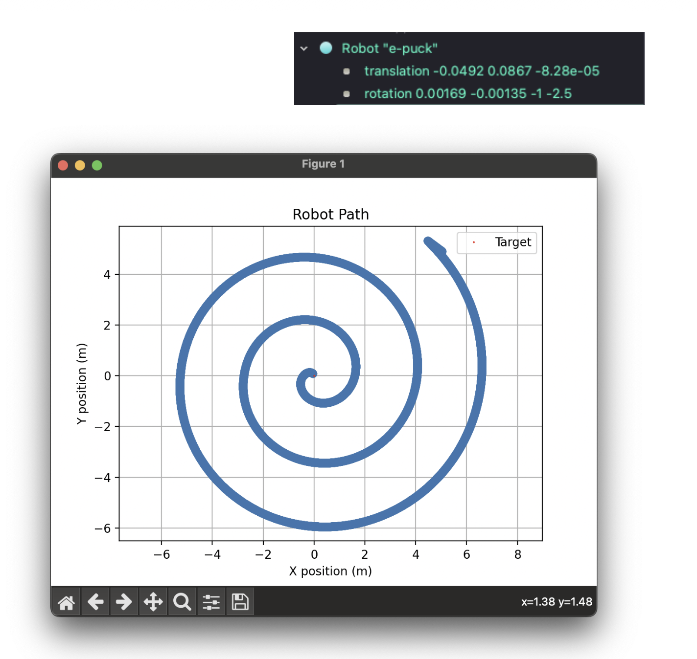
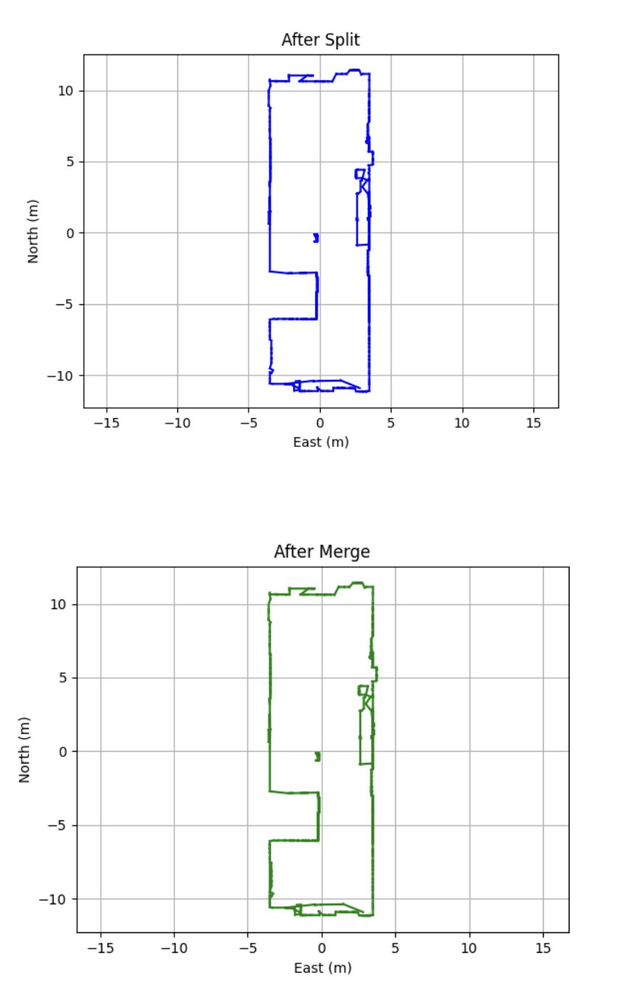
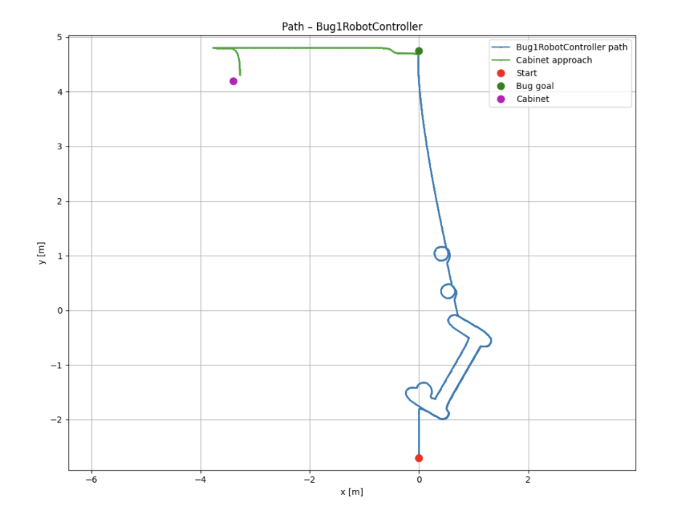
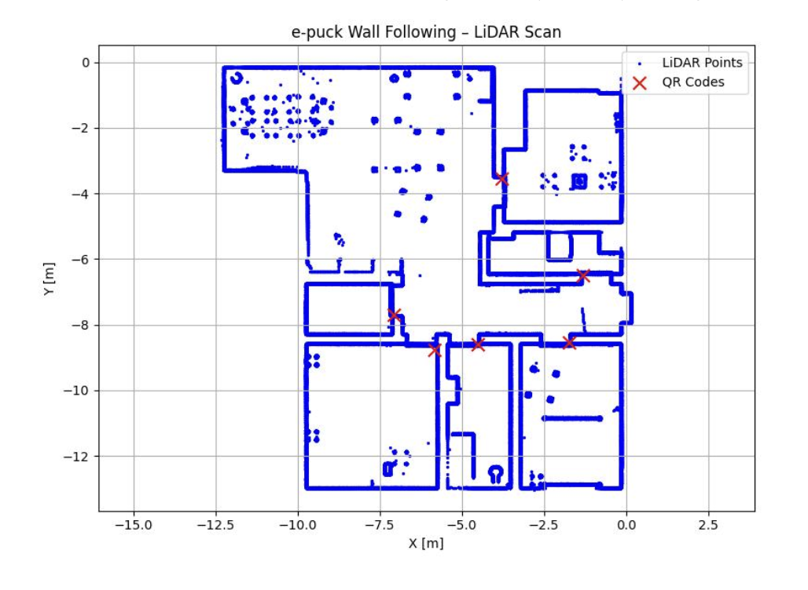
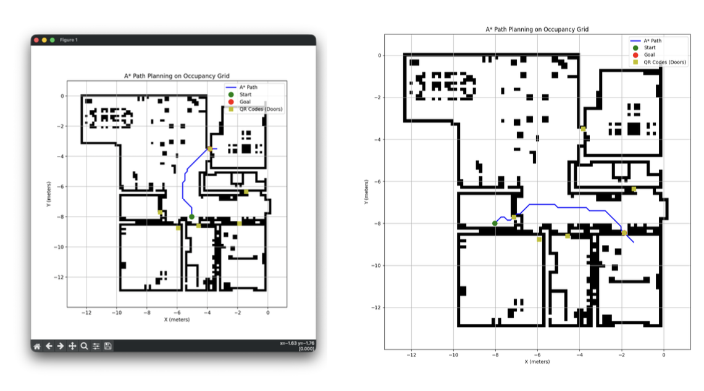

# Fundamentals of Robotics Coursework

A collection of robotics exercises and a ground-robot project developed in **Webots** with **Python**. The work progresses from differential-drive control and odometry to mapping, localization, and path planning.

## Homework 1 — Differential-Drive Motion and Control

- **`Q1.py` — Motion simulation:** Apply constant and time-varying wheel velocities to an e-puck and plot its trajectory.
- **`Q2.py` — Heading control:** Use compass feedback and a proportional (P) controller to rotate toward a desired heading.
- **`Q3.py` — Inverse kinematics:** Convert commanded linear/angular velocities into wheel speeds and visualize the resulting paths.
- **`Q4.py` — Go-to-goal control:** Implement a pose-based proportional controller using distance and orientation errors to drive toward the origin.

Webots scene: `HW1/worlds/hw1.wbt`.

## Homework 2 — Odometry and Geometric Mapping

- **`Q1.py` — Forward kinematics and odometry:** Integrate wheel motion to estimate pose; compare predicted trajectories and headings with GPS/compass measurements under different wheel-speed profiles.
- **`Q2.py` — Scan processing:** Collect distance-sensor readings while navigating and rotating; reconstruct line segments using iterative end-point fit (IEPF) splitting and merge-neighboring-edges (MNE) merging.

Webots scenes: `HW2/FOR-HW2-401243045-401243069/Q1.wbt` and `Q2.wbt` (same directory).

## Homework 3 — Reactive Obstacle Avoidance

Implement and compare **Bug0**, **Bug1**, and **Bug2** navigation with goal seeking and wall following. Each algorithm uses a common Webots controller foundation (`base_bug.py`), but follows a different rule for leaving obstacles and resuming progress toward the goal.

Code: `HW3/Bug0.py`, `HW3/Bug1.py`, `HW3/Bug2.py`, and `HW3/base_bug.py`. Scene: `HW3/kindergarten-new.wbt`.

## Final Project — Ground-Robot Mapping, Localization and Planning

1. **e-puck mapping (`Project/mapping/epuck-mapping.py`):** Wall following, LiDAR point-cloud collection, QR-code detection, and export of map/landmark data.
2. **Occupancy-grid construction (`Project/navigation/occupancy grid.py`):** Convert recorded LiDAR points into a discrete occupancy map.
3. **Particle-filter localization (`Project/localization/`):** Estimate a mobile robot's pose using odometry, LiDAR observations, and QR-code/room cues. **Experimental:** the reported implementation did not reliably converge.
4. **A* navigation (`Project/navigation/a_star_planner.py`):** Plan from a known start position to a selected QR-code landmark on the occupancy grid, with a penalty for proximity to obstacles.

Simulation scene: `Project/worlds/epuck.wbt`. Selected generated scans, occupancy grids, landmark data, and sample paths are included alongside the scripts.

## Tools

- **Webots** for robot simulation
- **Python**, NumPy, Matplotlib, pandas, SciPy, Pillow and pyzbar for control, analysis, visualization and QR-code detection

See `Project/requirements.txt` for the project's Python packages. Webots must be installed separately; some controller scripts contain machine-specific Webots paths that may need adjusting.
